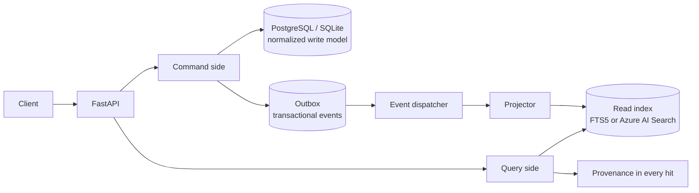
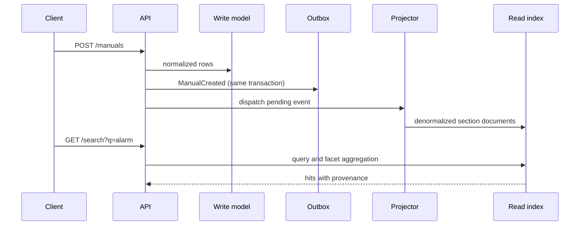
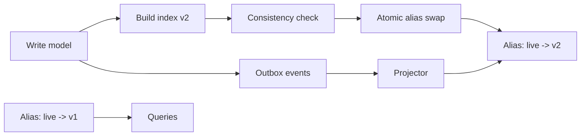

# cqrs-faceted-search

A small CQRS reference implementation for searching a synthetic catalog of industrial equipment manuals. The corpus contains only invented manuals for pumps, compressors, conveyors, HVAC units, forklifts, and generators from invented manufacturers.

## Problem

A document catalog has two workloads that pull in different directions. Writes need normalized, transactional data and reliable audit history. Search needs denormalized text, facets, ranking, and fast reads. Running both workloads against one model makes search queries fight writes. Rebuilding an index in place causes downtime or exposes a half-built index. A result without a precise source location is difficult to trust or debug.

## Pattern

The command side writes `manufacturers`, `manuals`, and `sections` with SQLAlchemy. Each command also writes a domain event to `outbox_events` in the same database transaction. A dispatcher consumes the outbox and a projector writes the current read index. Every hit carries the manual, section, character offsets, ingest version, and source event ID needed to resolve it back to the write model.

SQLite FTS5 is the local adapter. The optional Azure adapter uses `azure-search-documents` and `DefaultAzureCredential`; it is not imported by local tests. Production database configuration is PostgreSQL through `DATABASE_URL`.





### Rebuilds without write downtime

Rebuild creates a new index version beside the live version. It repopulates from the write model, re-snapshots under a short write lock, checks document counts, facet counts, and sampled text/provenance resolution, then swaps the `live_index` alias. Writes after the swap project to the new version.



## Run locally

Requirements: Python 3.12, Node 20, npm, and the Bicep CLI for infrastructure validation.

```sh
python3.12 -m pip install -e '.[test]'
make seed && make test && make web-build
```

That command seeds 300 deterministic manuals with `scripts/seed.py`, runs Python tests, builds the UI, and runs the Vitest test. To run the API:

```sh
make run
# http://localhost:8000/docs
```

Useful commands are `make rebuild`, `make bench`, and `make bicep-build`. The default local database is `./catalog.db`; set `DATABASE_URL` to a PostgreSQL URL for production-like use.

## API and provenance

`POST /manuals` creates a manual and its five sections. `PUT /manuals/{manual_id}/sections/{section_id}` updates a section. `DELETE /manuals/{manual_id}` retires a manual. `GET /search` accepts `q`, `category`, `manufacturer`, `year`, `doc_type`, `page`, and `page_size`.

Example search response:

```json
{
  "query": "isolate",
  "page": 1,
  "total": 1,
  "hits": [
    {
      "manual_id": "2f6b4d7e-7eb7-4ced-a083-2c75a7e7d2ce",
      "section_id": "bd9b691d-76c2-4c4e-8f15-8a37c9f3ef2b",
      "section_title": "Safety",
      "snippet": "isolate",
      "provenance": {
        "manual_id": "2f6b4d7e-7eb7-4ced-a083-2c75a7e7d2ce",
        "section_id": "bd9b691d-76c2-4c4e-8f15-8a37c9f3ef2b",
        "section_title": "Safety",
        "char_offset_start": 7,
        "char_offset_end": 14,
        "ingest_version": 1,
        "source_event_id": "7df8f4be-f5b4-4a87-bd57-0dd62e6a3f17"
      }
    }
  ],
  "facets": {
    "category": [{"value": "pumps", "count": 1}],
    "manufacturer": [{"value": "Acme Industrial", "count": 1}],
    "year": [{"value": 2024, "count": 1}],
    "doc_type": [{"value": "service manual", "count": 1}]
  }
}
```

The IDs above are illustrative response shape; IDs generated by the API are UUIDs.

## Local latency

Run `make bench` after seeding to measure the machine running the test. The benchmark performs repeated local FTS5 queries over the seeded corpus and reports p50 and p95.

| corpus | queries | p50 (ms) | p95 (ms) |
|---|---:|---:|---:|
| local SQLite FTS5 | 100 | 3.20 | 3.70 |

## Tradeoffs

- Eventual consistency is explicit. The outbox and projector add a lag window between a successful write and a searchable result; the API dispatches synchronously for the local MVP, while production can run the dispatcher independently.
- There are two models to maintain. The normalized model protects writes and the index optimizes reads, but projection mappings and rebuild checks add code.
- Rebuilds cost storage and I/O because blue and green versions coexist. The consistency check makes a bad index fail before alias swap.
- FTS5 is cheap, local, and deterministic but has less relevance tuning and operational scale than Azure AI Search. Azure provides managed scale and richer ranking at a cost.
- The basic Azure Search and PostgreSQL resources are not free at production scale. The Bicep template keeps secrets out of the repo and uses managed identity for search access.

## What I would do in production

Use PostgreSQL Flexible Server with Entra authentication, a durable worker for outbox delivery with idempotency and retry, and Azure AI Search with a versioned index alias. Add metrics for outbox age, projection lag, rebuild duration, failed events, query latency, and provenance check failures. Use schema-versioned events, a dead-letter path, retention policies, authenticated API ingress, private endpoints, and an automated deployment that requires an explicit workflow dispatch. Keep the local FTS5 adapter for developer feedback and fast tests.

## Infrastructure and CI

`infra/main.bicep` defines Azure AI Search Basic, PostgreSQL Flexible Server with password authentication disabled, Event Grid, Container Apps, Static Web App, Log Analytics, a user-assigned identity, and a GitHub OIDC federated credential. The identity receives Search Index Data Contributor. `ci.yml` runs Ruff, pytest, the web build and Vitest, Bicep compilation, Gitleaks, and the deny-list check. `deploy.yml` is `workflow_dispatch` only and uses OIDC.
